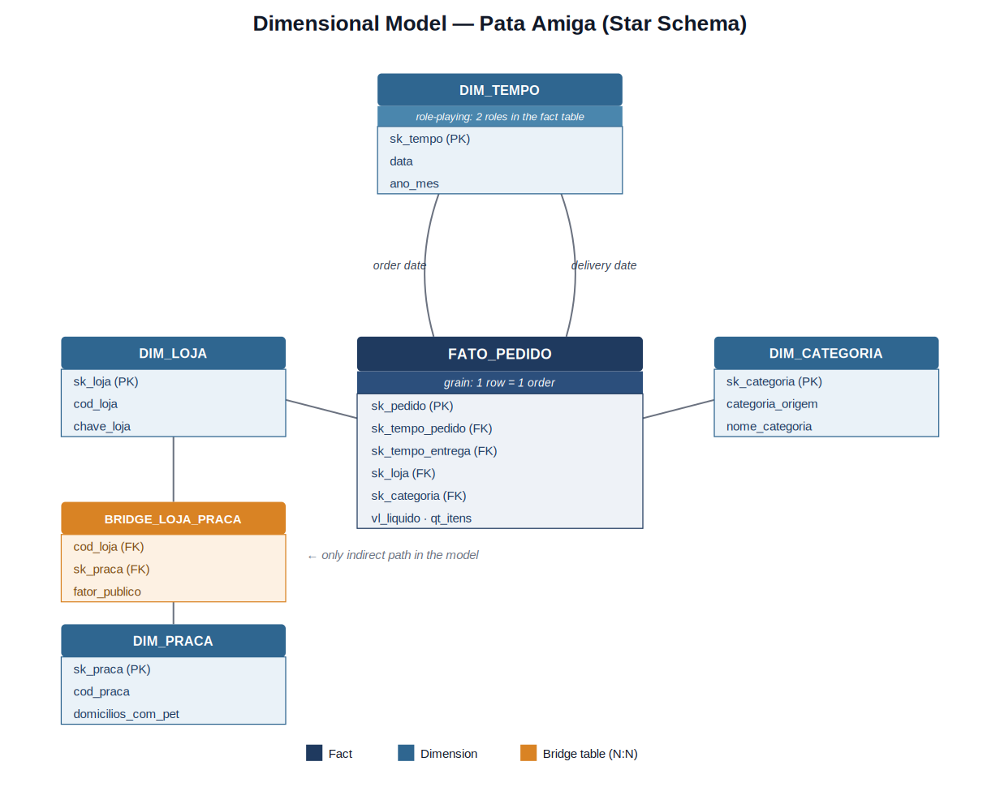

# 🐾 Pata Amiga — Data Warehouse & Retail Analytics

Dimensional data model (Star Schema) and analytical study of **4,044 orders** from **Pata Amiga** (a 32-store pet shop chain in Santa Catarina, Brazil) recorded between **September 2023 and March 2024**, built from three denormalized source systems (e-commerce platform, franchise store registry, and service region spreadsheets).

## Table of Contents
1. [Context & Business Problem](#1-context--business-problem)
2. [Source Data Diagnostics](#2-source-data-diagnostics)
3. [Dimensional Model (Star Schema)](#3-dimensional-model-star-schema)
4. [ETL & Data Treatment Decisions](#4-etl--data-treatment-decisions)
5. [How to Reproduce the Database from Scratch](#5-how-to-reproduce-the-database-from-scratch)
6. [The Five Business Answers](#6-the-five-business-answers)
7. [Final Executive Recommendation](#7-final-executive-recommendation)

---

## 1. Context & Business Problem

**Pata Amiga** is a pet shop chain in Santa Catarina operating **32 stores**. In September 2023, the company unified its order operations (mobile app, website, phone, WhatsApp, and physical stores) with its delivery logistics, generating **4,044 orders** over seven months.

These records originated across three disconnected systems — the **e-commerce platform**, the **franchising store registry**, and the **expansion team's service region (*praças*) spreadsheet** — each suffering from inconsistent formatting and lack of standardization. This project integrates these three sources into a **Dimensional Data Warehouse (Star Schema)** in MySQL and answers five core executive questions:
1. Where is the delivery bottleneck?
2. Which product category drives total revenue?
3. Is the discount policy consistent across sales channels?
4. Where is revenue concentrated by service region (*praça*)?
5. Where should the next store be opened?

---

## 2. Source Data Diagnostics

Audited directly from the three raw staging tables (`stg_pedido`, `stg_loja`, `stg_loja_praca`) prior to any data cleaning (`00-conferencia.sql`):

| Diagnostic Metric | Value |
| :--- | :--- |
| Rows in `stg_pedido` / `stg_loja` / `stg_loja_praca` | 4,044 / 32 / 48 |
| Distinct spellings of Store Name | 50 |
| Distinct spellings of Product Category | 18 |
| Distinct spellings of "Discount Applied" (`Houve Desconto`) | 12 |
| Distinct spellings of Order Channel | 8 |
| Orders missing Store Code (`Cod Loja`) | 1,575 (~39%) |
| Orders missing Store Name (`Loja-Nome` — unidentifiable store) | 3 |
| Blank "Picking" (`Separação`) milestone | 1,077 |
| Blank "Invoice" (`Nota Fiscal`) milestone | 1,338 |
| Blank "Dispatch" (`Despacho`) milestone | 1,665 |
| Blank "Delivery" (`Entrega`) milestone | 1,953 |

> **Important Note:** The 1,575 orders missing `Cod Loja` do **not** mean 1,575 unidentified stores — the pipeline resolves store identity via the standardized store name (`Loja-Nome`), which is present in almost all cases. Only **3 orders** truly lack an identifiable store (both code and name are blank), and those 3 are mapped to the `-1` surrogate row in the dimension. Furthermore, blank logistics milestones are not ingestion errors: they represent open/in-progress orders whose subsequent stages had not yet occurred when the data extraction window closed.

---

## 3. Dimensional Model (Star Schema)

* **Fact & Dimensions:** One central fact table (`fato_pedido`, grain = 1 row per order) and four dimensions: `dim_tempo` (date/calendar), `dim_loja` (store), and `dim_categoria` (category) linked directly to the fact table, plus `dim_praca` (service region) linked indirectly via the bridge table `bridge_loja_praca` (handling the model's only N:N relationship, as a single store can serve multiple regions).
* **Role-Playing Dimension:** `dim_tempo` is referenced twice in the fact table to represent both the **order date** (`sk_tempo_pedido`) and the **delivery date** (`sk_tempo_entrega`) using a single shared calendar table.
* **Referential Integrity (`-1` Unknown Member):** Every dimension contains a default `-1 = "Não Informado"` (*Not Informed*) row, ensuring that no Foreign Key (`FK`) in the fact table is ever `NULL` when source data is missing.

---

## 4. ETL & Data Treatment Decisions

* **Dates:** Raw order dates arrive in US format with AM/PM (`11/16/2023 02:30 PM`) and are parsed via `STR_TO_DATE(coluna, '%m/%d/%Y %h:%i %p')`. The four logistics milestones already arrive in ISO format (`2023-11-16`), requiring only `DATE()`. Applying a Brazilian date mask (`%d/%m/%Y`) would not throw an error, but would silently return `NULL` or inverted dates — therefore, the US mask was verified beforehand against all 4,044 records.
* **Monetary Values & Quantities:** Blank strings or `-` are converted to `NULL`, never `0` (a stage that "did not happen" is analytically distinct from "happened at zero cost"). Net order value (`valor_liquido`) coexisted in three string formats (`R$ 1.850,00`, `1850.00`, `1.200`) and was sanitized using conditional string expressions prior to casting to `DECIMAL`.
* **Product Categories:** 18 raw spelling variations were mapped into 7 canonical categories via `CASE WHEN`. **Evaluation order matters:** `MED` is evaluated before `RA` because *"Ração Medicamentosa"* (Medicated Pet Food) contains the substring `"RA"` and would otherwise be misclassified as standard pet food. MySQL's default collation handles case and accent insensitivity automatically.
* **Store Names:** Always standardized prior to joining with `dim_loja`. A mechanical `REPLACE` strips the `/SC` state suffix and double spaces; subsequently, a targeted `CASE` statement resolves the 3 remaining anomalies (typos, nicknames, and abbreviations).
* **Discounts & Channels:** Because these are small, low-cardinality domains without descriptive attributes, they were standardized directly as degenerate dimensions inside the fact table load. In the channel rules, **evaluation order matters:** `"WHATSAPP"` contains `"APP"`, so `WHATS` is evaluated prior to `APP`.
* **Service Region Proration (*Rateio*):** The bridge table `bridge_loja_praca` stores an audience weight factor (`fator_publico`, summing to `1.00` per store). Revenue is multiplied by this factor before aggregating by region, preventing double-counting when a store serves two regions.

---

## 5. How to Reproduce the Database from Scratch

Execute the scripts inside the `sql/` folder in the exact order below using **MySQL 8.0+**:

| Order | Script File | Description |
| :--- | :--- | :--- |
| **1** | `01-carga-staging.sql` | Creates the `dw_pata_amiga` database and loads the 3 raw staging tables. |
| **2** | `02-dimensoes-prontas.sql` | Creates and populates `dim_tempo` (236 rows) and `dim_loja` (33 rows); creates the DDL skeleton for remaining tables. |
| **3** | `03-dimensoes.sql` | Builds and populates `dim_categoria`, `dim_praca`, and `bridge_loja_praca`. |
| **4** | `04-fato.sql` | Transforms and populates `fato_pedido` (4,044 rows). |
| **5** | `05-perguntas.sql` | Executes the 5 analytical business queries. |

*(Note: `00-conferencia.sql` is a standalone exploratory auditing script used for staging diagnostics).*

> ⚠️ **Connection Charset Warning:** When executing via CLI, explicitly enforce `utf8mb4` so the client does not default to `latin1` and corrupt accented characters during load:
>
>     mysql -u root --default-character-set=utf8mb4 < sql/01-carga-staging.sql

---

## 6. The Five Business Answers

### Q1 — Where is the delivery bottleneck?

| Store Size (*Porte*) | Orders | Order → Picking | Picking → Invoice | Invoice → Dispatch | Dispatch → Delivery | Total Lead Time |
| :--- | :--- | :--- | :--- | :--- | :--- | :--- |
| **Large (*Grande*)** | 1,763 | 2.0 | 0.6 | 3.3 | 2.0 | **7.9 days** |
| **Medium (*Média*)** | 1,663 | 2.0 | 0.6 | 3.3 | 2.0 | **8.0 days** |
| **Small (*Pequena*)** | 615 | 3.0 | 0.7 | **8.5** | 2.9 | **15.2 days** |
| *(Unidentified store)* | 3 | 2.0 | 0.0 | 4.0 | 3.0 | **8.5 days** |

*(Averages in days, excluding uncompleted milestones).*

Across all three store sizes, the longest stage is the exact same interval: **Invoice Issuance → Carrier Dispatch** (`Nota → Despacho`). However, it is heavily skewed: in **Small stores**, this single internal stage takes **8.5 days**, pushing total delivery time to **15.2 days** (nearly double the chain average). The bottleneck is not last-mile carrier transit, but internal store handoff before the carrier is even triggered.

---

### Q2 — Which category drives total revenue?

| Category (*Categoria*) | Net Revenue (BRL) | % of Total |
| :--- | :--- | :--- |
| **Pet Food (*Ração*)** | R$ 1,076,202.55 | **60.0%** |
| **Medication (*Medicamento*)** | R$ 305,904.03 | **17.1%** |
| **Treats (*Petisco*)** | R$ 128,590.16 | **7.2%** |
| **Services (*Serviço*)** | R$ 94,001.37 | **5.2%** |
| **Hygiene (*Higiene*)** | R$ 92,314.45 | **5.2%** |
| **Accessories (*Acessório*)** | R$ 64,661.39 | **3.6%** |
| **Toys (*Brinquedo*)** | R$ 31,634.56 | **1.8%** |

**Pet Food (*Ração*)** accounts for **60% of the chain's total revenue** (more than all other six categories combined) and ranks #1 across all store sizes without exception, acting as the core anchor product for the business.

---

### Q3 — Does the discount policy perform equally across channels?

| Order Channel | Avg. Ticket WITHOUT Discount | Avg. Ticket WITH Discount | % of Total Revenue |
| :--- | :--- | :--- | :--- |
| **Mobile App** | R$ 167.63 | R$ 488.04 | 30.8% |
| **Website (*Site*)** | R$ 189.68 | R$ 501.92 | 25.1% |
| **Physical Store (*Loja Física*)** | R$ 197.55 | R$ 494.04 | 20.1% |
| **WhatsApp** | R$ 179.26 | R$ 514.33 | 10.5% |
| **Phone (*Telefone*)** | R$ 195.23 | R$ 514.02 | 6.9% |

Across every channel, the average ticket with a discount is **2.5x to 3x higher** than without a discount; no channel experiences ticket erosion from promotions. **Analytical Caveat (Correlation vs. Causation):** Observational order data demonstrates correlation, not causation — we cannot claim that discounts *cause* larger baskets, as stores may preferentially grant discounts to orders that are already large (e.g., progressive volume discounts).

---

### Q4 — Which service region (*praça*) concentrates revenue?

| Service Region (*Praça*) | Households with Pets | Prorated Revenue (BRL) |
| :--- | :--- | :--- |
| **Vale do Itajaí** | 148,000 | **R$ 633,746.09** |
| **Grande Florianópolis** | 132,000 | R$ 283,546.75 |
| **Norte Industrial** | 96,000 | R$ 175,431.90 |
| **Litoral Sul** | 58,000 | R$ 137,051.20 |
| **Litoral Norte** | 61,000 | R$ 128,872.75 |
| **Extremo Oeste** | 63,000 | R$ 98,359.18 |
| **Carbonífera** | 67,000 | R$ 88,707.42 |
| **Serra Catarinense** | 44,000 | R$ 80,477.64 |
| **Meio-Oeste** | 51,000 | R$ 58,955.63 |
| **Foz do Itajaí** | 74,000 | R$ 46,749.72 |
| **Planalto Norte** | 33,000 | R$ 31,100.84 |
| **Planalto Serrano** | 29,000 | R$ 29,323.10 |

*(Sum prorated by `fator_publico` in the bridge table + R$ 986.30 from the 3 unidentified store orders = **R$ 1,793,308.51**, matching exact chain net revenue).*

**Vale do Itajaí** generates **~R$ 4.28 per pet-owning household**, nearly double the runner-up region. It leads not merely because of market size, but because it converts disproportionately higher revenue per household.

---

### Q5 — Where to open the next store, and data limitations

**Top Stores by Relative Demand (Items per 1,000 inhabitants):**

| Store City | Population | Items / 1,000 Inhab. | Avg. Delivery Time |
| :--- | :--- | :--- | :--- |
| **Rio dos Cedros** | 11,322 | **41.9** | 14.2 days |
| **Presidente Getúlio** | 16,359 | **34.8** | 14.2 days |
| **Ibirama** | 18,613 | **32.1** | 15.4 days |
| **Itapoá** | 20,586 | **25.9** | 15.4 days |
| **S. Amaro da Imperatriz** | 22,357 | **23.7** | 15.9 days |

Stores with the highest per-capita demand are consistently located in **small municipalities** — and these are the exact stores suffering from the worst delivery times (~14–16 days), reinforcing finding Q1.

**Revenue by CURRENT Franchise Tier (*Faixa de Franquia*):**

| Franchise Tier | Net Revenue (BRL) | % of Total |
| :--- | :--- | :--- |
| **Gold (*Ouro*)** | R$ 1,011,264.38 | 56.4% |
| **Diamond (*Diamante*)** | R$ 382,209.74 | 21.3% |
| **Silver (*Prata*)** | R$ 314,812.03 | 17.6% |
| **Bronze** | R$ 84,036.06 | 4.7% |

* **Historical Tracking Limitation (Type 1 Overwrite):** The source store registry only stores a franchise's *current* tier (historical transitions were overwritten). Thus, the 56.4% attributed to "Gold" reflects revenue generated by stores currently classified as Gold, not what they sold while historically operating under that tier.

**Explicitly Measured Data Gaps (Accounted for, not hidden):**

| Data Gap / Incomplete Record | Record Count |
| :--- | :--- |
| Orders without identifiable store | 3 |
| Deliveries not yet completed within the data window | 1,953 (48.3%) |
| Orders with blank item quantity | 257 |
| Orders with blank monetary value | 121 |

---

## 7. Final Executive Recommendation

The data points to two simultaneous strategic actions:
* **Where to Expand:** Relative demand per capita is strongest in smaller cities (such as *Rio dos Cedros*, *Presidente Getúlio*, and *Ibirama*). Opening the next store has the highest probability of success in a small municipality with a similar demographic profile, particularly within the **Vale do Itajaí** region, which demonstrates superior household conversion.
* **What to Fix Before Expanding:** Those exact same small-format stores suffer from the severe operational bottleneck identified in Q1 (**8.5 days stalled between invoice issuance and carrier dispatch**). Opening another small store without first fixing the invoicing-to-dispatch workflow will replicate >15-day delivery times.
* **Analytical Boundaries (What Cannot Be Claimed):** The dataset does not capture external competitor presence; we cannot claim that the "Gold" franchise tier *causes* higher revenue (reverse causality is likely: high-revenue stores get promoted to Gold); and while the data pinpoints the exact process interval where time is lost (`Nota → Despacho`), identifying the operational root cause (staffing, ERP integration, or carrier collection frequency) requires on-site process auditing.
